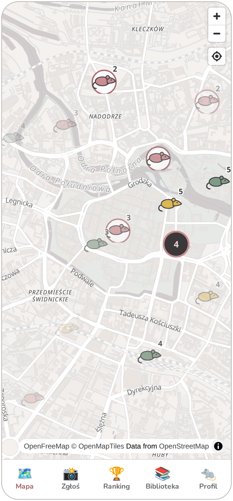
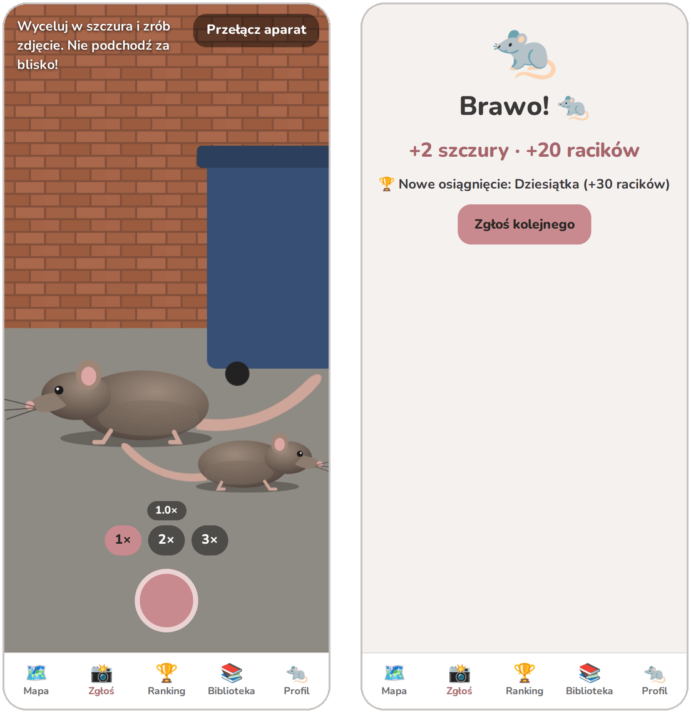
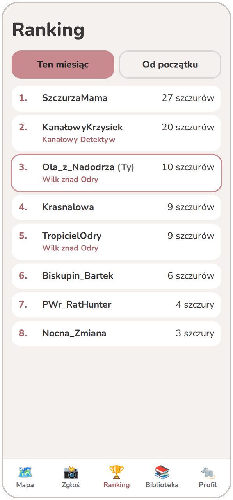
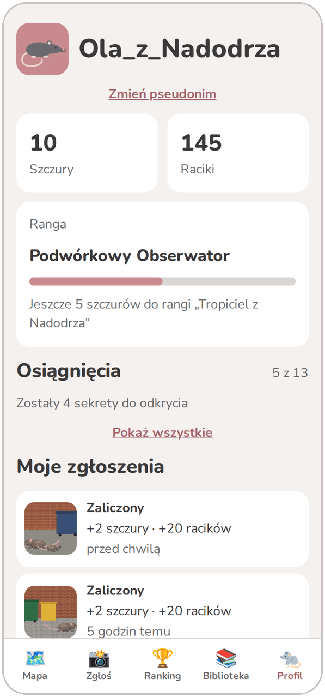
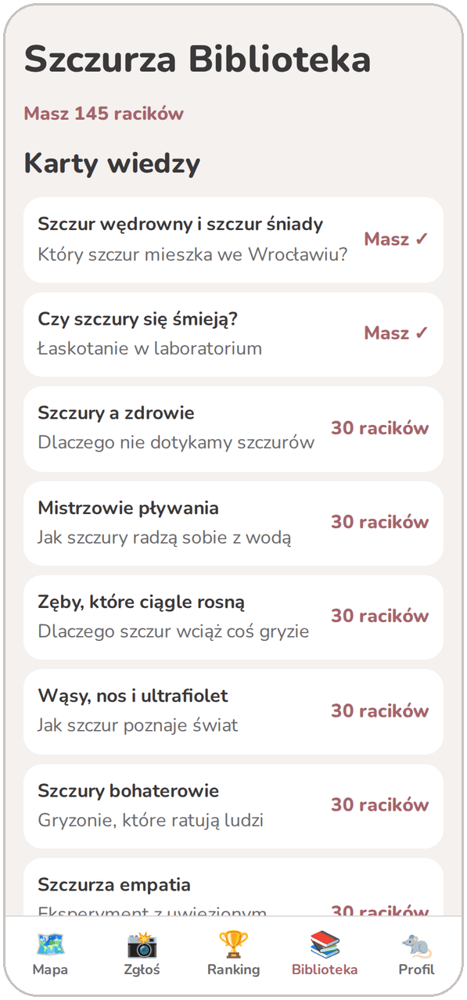
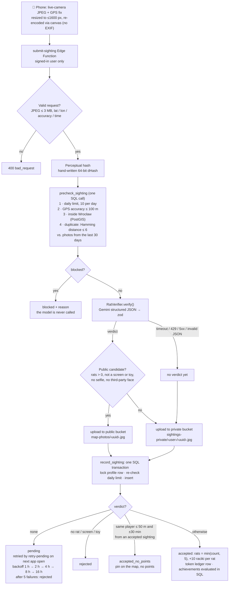

# Ratlas

**A citizen-science game for Wrocław: photograph a rat, let an AI verify it, put it on the city's shared rat map.**

### [▶ Open Ratlas](https://ratlas.szczury.workers.dev/)

<p align="center">
  
</p>

Ratlas is an installable PWA. People in Wrocław photograph rats they meet with the live camera. A multimodal model checks each photo on the server, and accepted sightings go onto a shared city map where pins fade over 7 days. Players collect points and an in-game currency (*raciki*), climb ranks and the monthly / all-time rankings, unlock public and secret achievements, and spend raciki in the *Rat Library* on knowledge cards, quizzes and pin skins.

- **Live:** [ratlas.szczury.workers.dev](https://ratlas.szczury.workers.dev/), best opened on a phone (Cloudflare Workers for the static PWA, Supabase for everything else).
- **Language:** the UI is in Polish. App strings live in an i18next resource file (`src/i18n/pl.json`), so it is ready for translation. The legal pages and product docs are Polish-only.

## What it does

1. **Spot a rat.** Open the *Zgłoś* (report) tab and take a photo. The app only uses the live camera, with no gallery upload, and attaches a GPS fix.
2. **The server checks it.** An Edge Function runs the cheap checks first (limits, GPS accuracy, city boundary, duplicate photo) and then asks the AI verifier how many real rats are in the photo and whether it shows a screen, a toy, a selfie or someone else's face.
3. **Score.** Each accepted rat counts as one point (max 5 per photo) and earns 10 raciki. Points also unlock achievements (6 public, 7 secret) and 7 ranks, from *Szczurzy Nowicjusz* to *Król Szczurów Wrocławia*.
4. **Explore and spend.** On the map, nearby pins merge into "nests" and you can tap one to see the photo or report abuse. Raciki buy 10 sourced knowledge cards, 3 quizzes, pin skins and titles that other players see on the map and in the rankings.

<p align="center">
  
</p>

| Rankings | Profile | Rat Library |
|:---:|:---:|:---:|
|  |  |  |

<sub>The screenshots come from a local instance with seeded demo accounts. The "photos" are generated illustrations, and the verdicts come from the fake verifier described below.</sub>

## How a sighting is verified

Everything that awards points happens on the server. This is how [`supabase/functions/submit-sighting`](supabase/functions/submit-sighting/index.ts) handles a request:



Some details:

- **Cheap checks before expensive ones.** All four prechecks run in one SQL call before the model is used. Blocked requests are free, and abuse can't burn the AI quota. The place cooldown runs later, inside the transaction, because it only affects points: the sighting still goes on the map.
- **Swappable verifier.** `RatVerifier` is a single-method interface ([`verification.ts`](supabase/functions/_shared/verification.ts)). The Gemini implementation sends the photo and a JSON response schema at temperature 0, and validates the answer with zod. Tags come from a closed list (bin, Wrocław dwarf statue, water, tram stop, rain), and secret achievements use those tags. `VERIFIER=fake` swaps in a deterministic fake for local development and tests.
- **Fail closed.** An incomplete verdict never accepts a sighting. A model outage is not an error for the user: the sighting waits as `pending` and is retried with exponential backoff.
- **Idempotent and race-safe.** `record_sighting` locks the player's profile row so parallel uploads can't exceed the daily limit. `resolve_pending` only updates rows that are still `pending`, so two concurrent retries can't award points twice.
- **Achievements are data.** Rules live as JSONB in the `achievements` table (`total_rats_gte`, `rats_in_photo_gte`, `streak_days_gte`, `hour_between`, `tag`, `selfie`). They are evaluated in SQL in the same transaction as the points, so adding an achievement of an existing type means adding a row.

## Trust and anti-cheat: "we don't trust the phone"

- **The client can't write scores.** Row Level Security lets players read only their own sightings, ledger and profile. Column-level grants let them change only two settings on their profile. Every function that changes points or raciki is a `security definer` SQL function that only `service_role` (the Edge Functions) can execute. Grants are explicit because automatic table exposure is turned off.
- **Token ledger.** Every raciki change (sighting, achievement, purchase, admin correction) is a row in `token_ledger`. The balance on the profile is a cached sum that a check constraint keeps non-negative. Purchases are atomic, lock the profile row and can't happen twice.
- **Layered limits.** The app uses the live camera only. The server checks GPS accuracy and the city boundary (the OSM administrative boundary of Wrocław, stored in PostGIS), detects duplicate photos by perceptual hash, enforces the daily limit and the 50 m / 30 min place cooldown, and counts at most 5 rats per photo. All thresholds live in an `app_config` table.
- **Community moderation.** Any visible pin can be reported. Three reports from different players hide it until an admin reviews it. Only players with at least one accepted rat can report, up to 10 reports a day, which stops throwaway accounts. Admins reverse points with a `correction` ledger entry.
- **Paid content stays server-side.** The library catalog never includes card or quiz content. The text is returned only after a purchase.

## Privacy by design

- **Faces never go public.** Selfies and photos showing another person's face are stored only in a private bucket. Storage RLS lets only the author (and admins) open them, and those sightings never show on the map. The map query also requires the photo to be in the public bucket.
- **No hidden metadata.** The photo is re-drawn through a canvas before upload, which drops EXIF data (including the camera's own GPS tag). The location sent is the app's GPS fix, and it is checked for accuracy.
- **Rejected photos are deleted after 30 days.** The cleanup runs in `retry-pending` when the player opens the app.
- **Real account deletion.** `delete-account` removes every photo from both buckets, sweeps the player's private folder for leftovers, then deletes the auth user. A database cascade removes the profile, sightings, ledger, reports, achievements and purchases. If photo removal fails, deletion stops so no photos are left behind.
- **Minimal identity.** Other players only ever see a nickname, and it can be hidden on the map. Using photos to train a future model needs a separate opt-in. The spec requires that the AI provider must not train on uploaded photos.

## Tech stack

| Area | Choices |
|---|---|
| Frontend | React 19, TypeScript, Vite, `vite-plugin-pwa` (installable on Android and iOS), MapLibre GL with OpenFreeMap vector tiles (restyled in code), i18next |
| Backend | Supabase: Postgres + PostGIS, RLS, `security definer` RPCs, Auth (Google OAuth and a 6-digit email code), Storage |
| Server logic | Deno Edge Functions `submit-sighting`, `retry-pending` and `delete-account`. Shared modules avoid Deno APIs so Vitest can test them |
| AI | Gemini `generateContent` with a response schema, validated by zod, behind the `RatVerifier` interface. Image hashing is a hand-written dHash on `jpeg-js` |
| Hosting | Cloudflare Workers (static assets) + Supabase |
| Quality | Vitest + Testing Library, Playwright, pgTAP, oxlint |

## Testing

| Layer | Tooling | Size |
|---|---|---|
| Components, client logic, shared Edge Function modules (pipeline, verifier parsing, dHash, account deletion), eval summary | Vitest + Testing Library (jsdom) | **249 tests** in 44 files |
| Database: RLS, scoring, limits, geofence, cooldown, achievements, ranking, moderation, library purchases, storage policies | pgTAP (`supabase test db`) | **153 assertions** in 9 files |
| End-to-end on a real local stack: email-code login through Mailpit, onboarding, map, profile and ranking, nickname change and account deletion, buying and reading a knowledge card | Playwright (Pixel 7 emulation) | **4 scenarios** |
| Full submit → score → delete-account flow against the local Edge Functions | `npm run smoke` | 10 checks |

## AI verifier evaluation

[`scripts/eval-verifier.ts`](scripts/eval-verifier.ts) (`npm run eval`) runs the real Gemini verifier over a labelled set of your own photos (see [`eval/README.md`](eval/README.md)). The photos and labels are gitignored, so they never enter the repo. It reports:

- **precision and recall** for "this is a real rat" (screens and toys count as negatives),
- **count accuracy**: how many true positives got the exact number of rats,
- **selfie and third-party face accuracy**, with every privacy miss (a face that would have reached the public map) listed separately,
- unanswered requests and a list of mistakes.

The acceptance target from the spec is **precision ≥ 95%** for "this is a rat". No evaluation results are published in this repository yet. The harness and its scoring logic (unit-tested in `scripts/eval/summary.test.ts`) are in place, and the labelled photo set stays local.

## How it was built

Michał Plata built Ratlas with an AI-agent workflow in Claude Code. He wrote and approved the product spec and five implementation plans ([`docs/superpowers/`](docs/superpowers/), in Polish). He also made the product and architecture decisions: a PWA instead of app stores, scoring as SQL transactions behind RLS, a swappable AI verifier and privacy rules, among others. Agents implemented the plans task by task with test-driven development, and he reviewed the work. Decisions that changed during implementation are written back into the spec (sections 15–17), so the docs match the code.

## Run locally

**Prerequisites:** Node.js 20.19+ or 22.12+, Docker (for the local Supabase stack). The Supabase CLI comes in as a dev dependency, so `npx supabase` works after `npm install`.

```bash
npm install
npm run db:start                    # local Supabase in Docker; applies all migrations (first run takes a few minutes)

cp .env.example .env.local          # set VITE_SUPABASE_PUBLISHABLE_KEY from `npx supabase status`
cp supabase/functions/.env.example supabase/functions/.env   # VERIFIER=fake by default, no API key needed

npm run functions:serve             # Edge Functions (keep running in a second terminal)
npm run dev                         # http://localhost:5173
```

Log in with any email address. The 6-digit code arrives in the local Mailpit inbox at http://127.0.0.1:54324.

With `VERIFIER=fake`, every photo counts as `FAKE_RAT_COUNT` rats, so you can test the whole flow without an AI key. To use the real model locally, put `GEMINI_API_KEY` in `supabase/functions/.env` and remove the `VERIFIER=fake` line. The fake verifier must **never** be enabled in production because it accepts every photo.

| Script | What it does |
|---|---|
| `npm test` | Vitest suite |
| `npm run test:db` | pgTAP database tests (needs `db:start`) |
| `npm run e2e` | Playwright end-to-end tests (needs `db:start` and `functions:serve`) |
| `npm run smoke` | Smoke test of submit / retry / delete-account against the local functions |
| `npm run eval` | AI verifier evaluation on your labelled photos (needs a Gemini key) |
| `npm run lint` / `npm run build` | oxlint / type-check and production build |
| `npm run db:stop` | Stop the local Supabase stack |

## Repository map

```
src/                     React app: auth, onboarding, report (camera, GPS), map, ranking, library, profile, i18n
supabase/migrations/     schema, RLS, SQL scoring, achievements, ranking, library, city boundary
supabase/functions/      Edge Functions + _shared modules (pipeline, verifier, dHash, cleanup)
supabase/tests/          pgTAP tests
tests/e2e/               Playwright tests
scripts/                 smoke test, AI evaluation, city-boundary fetcher
docs/superpowers/        product spec and implementation plans (Polish)
```
